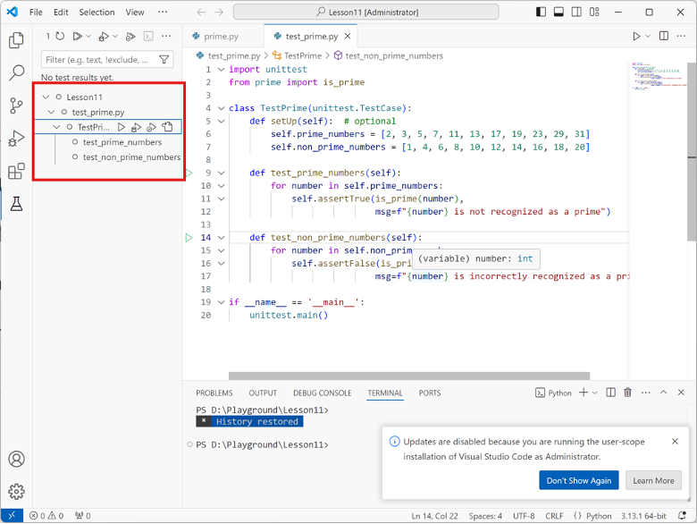
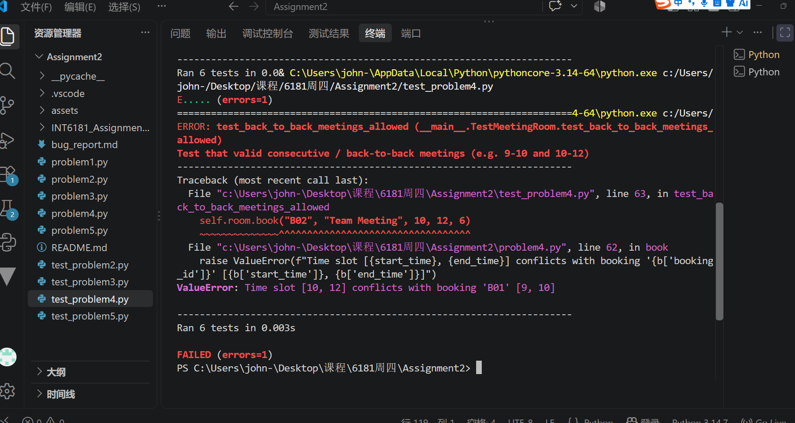
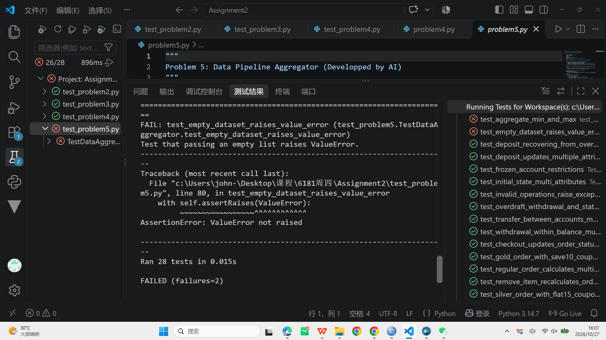

# Bug Report

This report documents the bugs discovered in the buggy programs, including the failing test cases, root cause analysis, and the applied code fixes.

---

## Bug Report 1: (Example)

### 1. Program Under Test
- **File:** `problemX.py`
- **Class / Function:** `YourClassName.method_name()`

### 2. Failing Test Case
Provide the unit test code from `test_problemX.py` that exposed the bug and failed during execution:

```python
# Paste your failing test method here
def test_example_failure(self):
    pass
```

Provide the captured test runs from VSCode.



**Test Output / Error Message:**
```text
# Paste error traceback / assertion failure message here
```

### 3. Root Cause Analysis
Explain why the bug occurred and what incorrect behavior it caused:
- **Expected Behavior:** (What should happen according to the specifications)
- **Actual Behavior:** (What happened in the starter code)
- **Root Cause:** (Explanation of the bug in the code logic)

### 4. Code Fix & Diff
Show the changes made to `problemX.py` to fix the bug:

```diff
- # Original buggy code line
+ # Corrected code line
```

---

## Bug Report 2: (Your discovery)

Write down your discovered bugs and solutions to address them as above. You may add more bug reports if needed.
### Bug Report 2: Back-to-Back Meetings Incorrectly Rejected

#### 1. Program Under Test
- File: `problem4.py`
- Class / Function: `MeetingRoom.book()`

#### 2. Failing Test Case

```python
def test_back_to_back_meetings_allowed(self):
    self.room.book("B01", "Morning Meeting", 9, 10, 5)
    self.room.book("B02", "Team Meeting", 10, 12, 6)
```

Provide the captured test runs from VSCode.



#### Test Output / Error Message

```text
ValueError: Time slot [10, 12] conflicts with booking 'B01' [9, 10]
```

#### 3. Root Cause Analysis
- Expected Behavior: Two meetings that share an endpoint should be allowed when one meeting ends exactly when the next begins.
- Actual Behavior: The second booking raised a `ValueError`.
- Root Cause: The conflict detection condition used strict comparisons and incorrectly treated consecutive meetings as overlapping.

#### 4. Code Fix & Diff

```diff
- if not (end_time < b["start_time"] or start_time > b["end_time"]):
+ if not (end_time <= b["start_time"] or start_time >= b["end_time"]):
```

---

### Bug Report 3: Minimum and Maximum Aggregation Reversed

#### 1. Program Under Test
- File: `problem5.py`
- Class / Function: `clean_and_aggregate()`

#### 2. Failing Test Case

```python
def test_aggregate_min_and_max(self):
    min_result = clean_and_aggregate(
        self.sample_sales, group_by="region",
        metric="sales", aggregation="min"
    )
    max_result = clean_and_aggregate(
        self.sample_sales, group_by="region",
        metric="sales", aggregation="max"
    )
    self.assertAlmostEqual(min_result["North"], 100.0)
    self.assertAlmostEqual(max_result["North"], 200.0)
```

Provide the captured test runs from VSCode.



#### Test Output / Error Message

The test failed because the `min` and `max` operations returned the opposite results.

#### 3. Root Cause Analysis
- Expected Behavior: The `min` operation returns the smallest value, and `max` returns the largest value in each group.
- Actual Behavior: The two operations returned reversed results.
- Root Cause: The implementation called `max(values)` for `min` and `min(values)` for `max`.

#### 4. Code Fix & Diff

```diff
elif agg_op == "min":
-    val = max(values)
+    val = min(values)
elif agg_op == "max":
-    val = min(values)
+    val = max(values)
```

---

### Bug Report 4: Empty Dataset Does Not Raise ValueError

#### 1. Program Under Test
- File: `problem5.py`
- Class / Function: `clean_and_aggregate()`

#### 2. Failing Test Case

```python
def test_empty_dataset_raises_value_error(self):
    with self.assertRaises(ValueError):
        clean_and_aggregate([], group_by="region", metric="sales")
```
Provide the captured test runs from VSCode.


#### Test Output / Error Message

```text
AssertionError: ValueError not raised
```

#### 3. Root Cause Analysis
- Expected Behavior: Passing an empty list should raise `ValueError`.
- Actual Behavior: The function returned without raising the expected exception.
- Root Cause: The function did not check whether `records` was empty before processing the input.

#### 4. Code Fix & Diff

```diff
+ if not isinstance(records, list):
+     raise TypeError("records must be a list")
+
+ if not records:
+     raise ValueError("records must not be empty")
```

